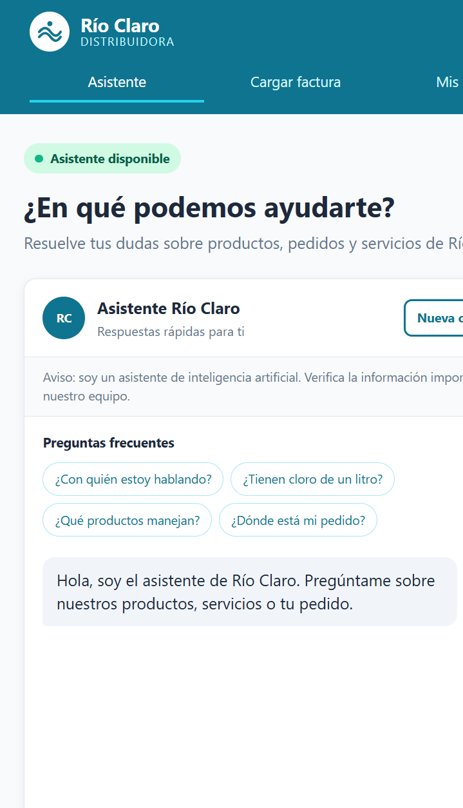
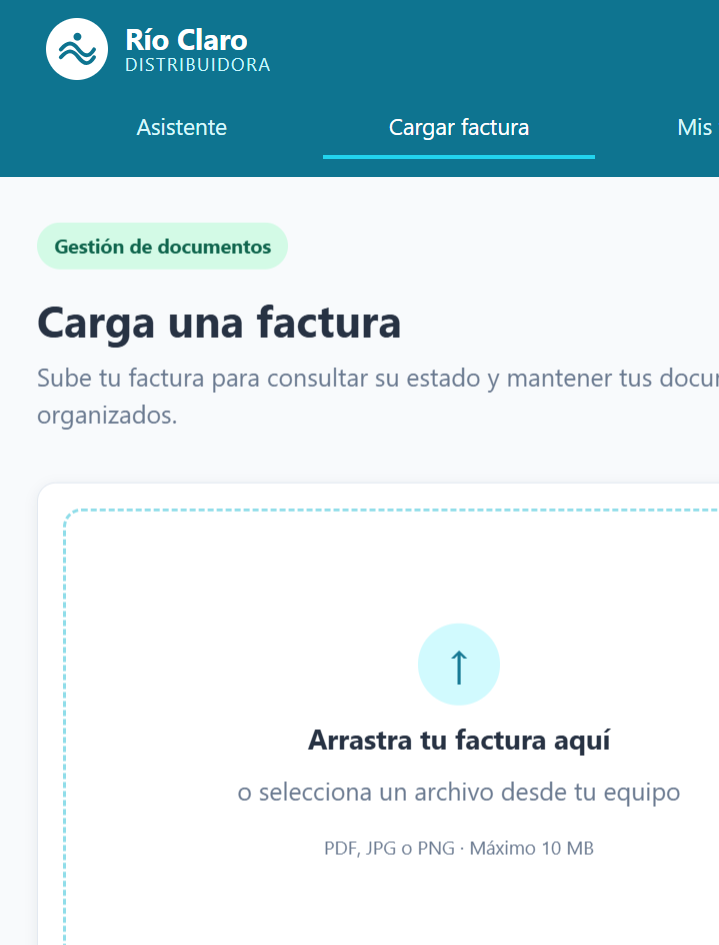
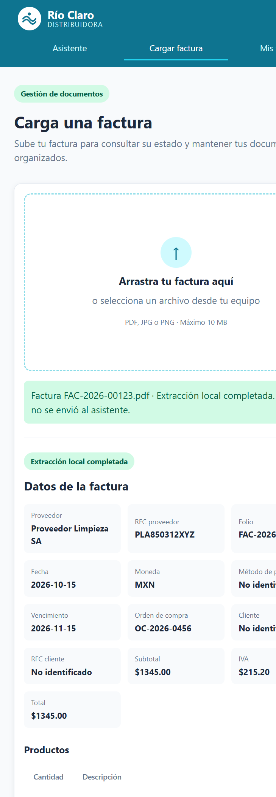
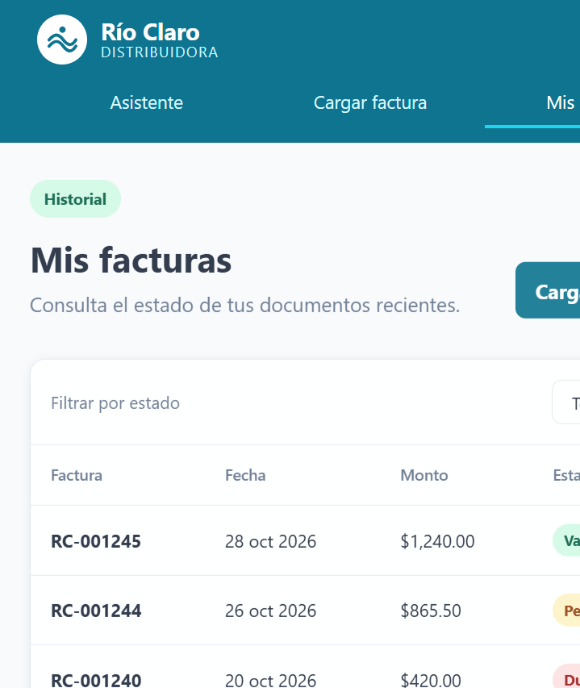
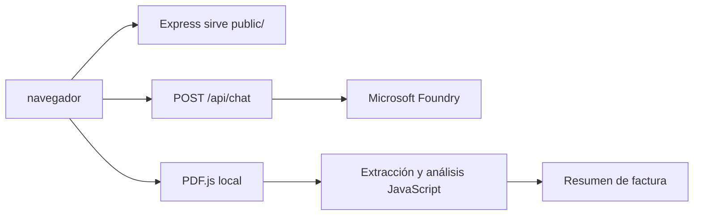

# Aplicación web de Distribuidora Río Claro

## Integrantes del equipo

- Jesús Rojas Hernández
- Aldo Hernández Díaz

## 1. Resumen

Este proyecto implementa una aplicación web para **Distribuidora Río Claro**. La solución combina:

- Un asistente conversacional conectado a Microsoft Foundry.
- Una interfaz web responsive, accesible y optimizada para móvil.
- Una sección independiente para cargar facturas PDF y extraer sus datos localmente con JavaScript.
- Una vista de consulta de facturas con estados visuales.

La aplicación está construida con HTML, CSS y JavaScript vanilla en el frontend, y Node.js con Express 5 en el backend.

## 2. Problema resuelto

La distribuidora necesita ofrecer a sus usuarios un punto único para:

1. Resolver dudas sobre productos, pedidos y servicios.
2. Consultar rápidamente preguntas frecuentes, como disponibilidad de cloro, catálogo y estado de pedidos.
3. Revisar información básica de facturas sin capturar manualmente todos sus datos.
4. Utilizar la solución desde computadoras y teléfonos móviles.
5. Mantener separada la información sensible de la conversación con el asistente.

Antes de esta solución, estas tareas podían requerir atención manual, búsquedas en distintos sistemas o captura repetitiva de datos. La aplicación centraliza la experiencia y reduce pasos para el usuario.

## 3. Capturas de la aplicación

### 3.1 Asistente conversacional

La pantalla principal presenta el nombre de la empresa, navegación, estado del servicio, preguntas frecuentes, burbujas de conversación, entrada de texto y botón de micrófono.



Características visibles:

- Header con logo y nombre de Río Claro.
- Mensaje de transparencia sobre el uso de inteligencia artificial.
- Preguntas frecuentes seleccionables.
- Botón para iniciar una nueva conversación.
- Chat con burbujas para usuario y asistente.
- Dictado por voz y lectura de respuestas cuando el navegador lo soporta.

### 3.2 Carga de factura

La sección de factura permite seleccionar o arrastrar un PDF. El procesamiento se realiza en el navegador y no se envía al asistente.



### 3.3 Lectura y resultado de la factura

> **Importante:** esta lectura de factura es una **simulación conceptual que ocurre únicamente en el navegador**. No la realiza el agente de Microsoft Foundry, no usa el endpoint `/api/chat` y no envía el archivo al asistente. El agente se utiliza exclusivamente para la conversación de preguntas y respuestas.

Cuando el usuario selecciona una factura PDF, la aplicación muestra el progreso de lectura y después presenta una tarjeta de resultados. El flujo es:

1. El usuario arrastra el PDF al área de carga o lo selecciona desde su equipo.
2. JavaScript valida que el archivo sea un PDF.
3. PDF.js lee el contenido de todas las páginas directamente en el navegador.
4. El texto se analiza con patrones para localizar encabezado, cliente, importes y productos.
5. La interfaz muestra los datos identificados y una tabla con las líneas de la factura.
6. El usuario puede limpiar el resultado y cargar otro documento.

Para una factura como la utilizada en las pruebas, el resultado esperado incluye:

| Grupo | Datos identificados |
|---|---|
| Proveedor | PROVEEDOR LIMPIEZA SA · RFC PLA850312XYZ |
| Documento | Folio FAC-2026-00123 · Fecha 2026-10-15 |
| Condiciones | MXN · Transferencia · Vencimiento 2026-11-15 |
| Compra | Orden OC-2026-0456 |
| Cliente | Distribuidora Río Claro SA de CV · RFC DRC990101ABC |
| Totales | Subtotal $1,345.00 · IVA $215.20 · Total $1,560.20 |
| Productos | 4 líneas con cantidad, descripción, precio unitario e importe |

La sección de resultados también muestra una advertencia cuando no logra reconocer alguna línea con el formato esperado. Esto evita presentar información incompleta como si fuera confiable.

La extracción no utiliza el chatbot: el archivo se mantiene en el navegador y solamente se envía al componente local de PDF.js. Para un PDF escaneado como imagen se requiere una etapa adicional de OCR.

La siguiente captura documenta el resultado real de esta simulación del frontend. No es una respuesta generada por el agente:



En la captura se observa el mensaje **“Extracción local completada. El archivo no se envió al asistente.”**, junto con el folio, fechas, proveedor, importes y productos detectados.

La extracción identifica, cuando el formato del documento lo permite:

- Proveedor y RFC.
- Folio y fecha.
- Moneda y método de pago.
- Fecha de vencimiento y orden de compra.
- Cliente y RFC.
- Subtotal, IVA y total.
- Cantidad, descripción, precio unitario e importe de cada producto.

### 3.4 Dashboard de facturas

La vista de facturas muestra una tabla de ejemplo con estados visuales y un filtro por estado.



Los estados utilizan el semáforo definido para el proyecto:

- **Verde:** factura validada.
- **Ámbar:** factura pendiente de revisión.
- **Rojo:** factura duplicada o con error.

## 4. Arquitectura de la solución



### Frontend

Los archivos principales son:

- [`public/index.html`](../public/index.html): estructura del header, chat, carga de factura, dashboard y footer.
- [`public/styles.css`](../public/styles.css): diseño responsive, tokens de color, accesibilidad visual y estados.
- [`public/app.js`](../public/app.js): navegación entre vistas, interacción del chat, Web Speech API y extracción de PDF.

### Backend

El backend se encuentra en [`server.js`](../server.js) y:

- Sirve la carpeta `public/`.
- Expone `GET /health`.
- Expone `POST /api/chat`.
- Crea o reutiliza conversaciones mediante `conversation_id`.
- Consulta al agente usando `@azure/ai-projects` 2.x y `agent_reference`.
- Usa `DefaultAzureCredential`, sin API keys.
- Responde `422` para mensajes inválidos y `502` con un mensaje genérico si Foundry falla.

## 5. Extracción local de facturas

La funcionalidad de factura utiliza `pdfjs-dist`. El navegador:

1. Recibe el archivo mediante un campo `input` o drag & drop.
2. Lee el archivo con `arrayBuffer()`.
3. Carga PDF.js desde `/vendor/pdfjs`.
4. Recorre las páginas y obtiene los elementos de texto.
5. Une el texto de las páginas.
6. Aplica expresiones regulares para reconocer los campos de la factura.
7. Muestra los datos en tarjetas y una tabla de productos.

Este diseño evita enviar el PDF al asistente o a Microsoft Foundry. Es apropiado para un concepto funcional y para PDFs con texto seleccionable.

### Limitación conocida

Si la factura es un escaneo o contiene únicamente una imagen, PDF.js no podrá obtener texto suficiente. Para ese caso sería necesario agregar OCR, por ejemplo con Tesseract.js, o un servicio especializado de lectura documental.

## 6. Diseño visual

La interfaz usa la paleta **“Fresca y Confiable”**:

| Uso | Color |
|---|---|
| Primario | `#0E7490` |
| Primario claro | `#22D3EE` |
| Éxito | `#10B981` |
| Acento | `#F97316` |
| Advertencia | `#F59E0B` |
| Error | `#EF4444` |
| Fondo | `#F8FAFC` |
| Superficie | `#FFFFFF` |
| Texto | `#1E293B` |

El diseño utiliza una columna centrada para el asistente en escritorio y se adapta a pantallas pequeñas de aproximadamente 360 px de ancho.

## 7. Seguridad y privacidad

- El navegador no se conecta directamente con Microsoft Foundry.
- Las credenciales se obtienen con `DefaultAzureCredential`.
- Los valores de Azure se configuran mediante `.env` y no se escriben en el código.
- El PDF de la sección de factura se procesa localmente en el navegador.
- El texto recibido del asistente se inserta con `textContent`.
- El backend limita los mensajes a 1–2000 caracteres.

## 8. Ejecución local

Desde PowerShell:

```powershell
cd C:\workspace\cursoIA\chatbot-foundry
npm.cmd install
npm.cmd run dev
```

Abrir:

```text
http://localhost:3000
```

Comprobar el estado:

```powershell
Invoke-RestMethod http://localhost:3000/health
```

Respuesta esperada:

```json
{"status":"ok"}
```

## 9. Verificación realizada

- La página principal responde HTTP 200.
- El endpoint `/health` responde `ok`.
- El endpoint `/api/chat` conserva el mismo `conversation_id` en un seguimiento.
- Un mensaje vacío responde HTTP 422.
- PDF.js y su worker se sirven correctamente desde el backend.
- `server.js` y `public/app.js` pasan la comprobación de sintaxis de Node.js.
- Las dependencias instaladas no reportan vulnerabilidades mediante `npm audit`.

## 10. Posibles mejoras futuras

- Agregar OCR para facturas escaneadas.
- Validar las facturas contra un backend o sistema contable.
- Persistir el historial de facturas por usuario autenticado.
- Reemplazar los datos de ejemplo del dashboard por una API real.
- Agregar exportación de resultados a JSON o CSV.
- Implementar pruebas automatizadas para distintos formatos de factura.
